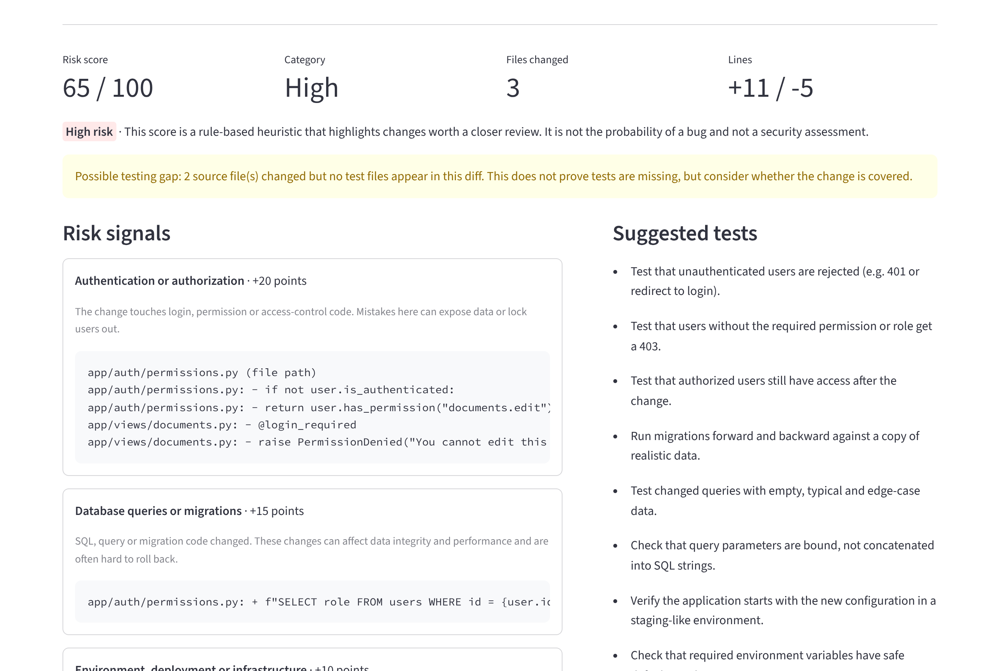

# PR Risk Radar

Cole um diff do Git e veja quais partes merecem uma revisão mais cuidadosa, por quê, e quais testes vale a pena adicionar. Cada ponto da nota vem de uma regra que você pode ler, e o app mostra as linhas que dispararam cada uma.

[](https://github.com/abiliocoe-source/pr-risk-radar/actions/workflows/tests.yml)
[](https://pr-risk-radar.streamlit.app/)

[](LICENSE)

**Demo:** https://pr-risk-radar.streamlit.app/ · A interface está em inglês. [Read in English](README.md).



> A nota é uma heurística que aponta mudanças que merecem atenção. **Não** é a probabilidade de existir um bug e **não** é uma avaliação de segurança.

## O problema

Numa revisão de código corrida, mudar uma linha numa checagem de permissão parece tão inofensivo quanto corrigir um erro de digitação. O PR Risk Radar aponta para as partes do diff que costumam pedir mais cuidado: autenticação e permissões, consultas e migrações de banco, dependências, configuração, mudanças muito grandes e proteções removidas.

## O que ele faz

Você cola um diff unificado (a saída de `git diff` ou o arquivo `.diff` de um pull request do GitHub) ou escolhe um dos três exemplos. O parser separa arquivos alterados, linhas adicionadas e removidas, renomeações, arquivos novos e apagados, e lida com diffs incompletos. O texto colado nunca é executado.

Cada arquivo é classificado como código, teste, dependência, configuração, documentação ou outro. A partir daí sai uma nota de 0 a 100 com a categoria Baixo, Médio ou Alto. Cada sinal mostra os pontos, uma explicação e as linhas que o dispararam, e o app sugere testes de acordo com o que mudou. Se código mudou e nenhum teste aparece no diff, há um aviso separado, que não soma pontos. A análise completa pode ser baixada em JSON.

Entradas vazias, inválidas ou maiores que 200 KB recebem uma mensagem clara.

## Como a nota é calculada

Cada regra soma seus pontos **no máximo uma vez**, não importa quantas linhas combinem. Assim, uma grande refatoração de autenticação não conta como vinte mudanças de autenticação. A nota final é a soma das regras disparadas, limitada a 100.

| Regra | Pontos | Disparada por |
|---|---|---|
| Autenticação / autorização | +20 | Caminhos como `auth/`, `oauth2.py`, `login`, `permissions`, `jwt`, ou código como `login_required`, `has_permission`, `IsAuthenticated`, `@PreAuthorize` |
| Banco de dados / SQL / migrações | +15 | Caminhos como `migrations/`, `alembic/`, `*.sql`, ou código como `SELECT … FROM`, `ALTER TABLE`, `cursor.execute(` |
| Dependências / build | +10 | `requirements.txt`, `pyproject.toml`, `package.json`, lock files, `go.mod`, `Makefile`… |
| Ambiente / deploy / infraestrutura | +10 | `Dockerfile`, `docker-compose*.yml`, `.env*`, `*.tf`, workflows de CI… |
| Mudança grande | +10 | Mais de 100 linhas alteradas |
| Mudança muito grande | +20 | Mais de 300 linhas (substitui a anterior) |
| Proteção removida | +20 | Uma linha removida parece checagem de acesso ou validação (`@login_required`, `raise PermissionDenied`, `abort(403)`) e não volta no mesmo arquivo |
| Proteção desligada | +10 | Uma linha adicionada desliga uma proteção (`verify=False`, `@csrf_exempt`, `AllowAny`) |
| Lacuna de testes | 0 | Código mudou, mas nenhum arquivo de teste aparece no diff |

Categorias: **Baixo** 0–29, **Médio** 30–59, **Alto** 60–100.

Algumas escolhas mantêm as regras precisas. Só linhas adicionadas e removidas são analisadas, nunca cabeçalhos ou contexto. Arquivos de teste e documentação ficam de fora, então um README que menciona `SELECT * FROM users` não aumenta a nota. Os padrões de código buscam identificadores e formatos de chamada (`has_permission`, `cursor.execute(`), não palavras soltas: `author = "Jane"` não conta como mudança de autenticação.

Os pesos são valores iniciais escolhidos para este projeto, não medições. Eles ficam como constantes nomeadas no topo de `risk_engine.py`.

## Arquitetura

```
pr-risk-radar/
├── app.py              # interface Streamlit: entrada, exemplos, resultado, exportação JSON
├── diff_parser.py      # texto -> ParsedDiff (arquivos, linhas, tipos, avisos)
├── risk_engine.py      # ParsedDiff -> RiskReport (nota, sinais, testes)
├── examples/           # três diffs de exemplo usados pela interface e pelos testes
├── tests/              # pytest + Streamlit AppTest
└── .github/workflows/  # CI: instala e roda os testes a cada push e pull request
```

O fluxo vai num sentido só: `app.py` chama `validate_input` e `parse_diff` de `diff_parser.py`, passa o resultado para `analyze` em `risk_engine.py` e mostra o `RiskReport`. O parser não sabe nada de risco e o motor não sabe nada de Streamlit, então cada parte é testada sozinha.

## Como rodar

Requer Python 3.11 ou mais novo.

```bash
git clone https://github.com/abiliocoe-source/pr-risk-radar.git
cd pr-risk-radar
python -m venv .venv
source .venv/bin/activate        # Windows: .venv\Scripts\activate
pip install -r requirements.txt
streamlit run app.py
```

Para analisar o seu próprio trabalho, gere o diff e cole o conteúdo no app:

```bash
git diff main...minha-branch > minha-mudanca.diff
```

## Testes

```bash
pip install -r requirements-dev.txt
python -m pytest
```

Os testes cobrem o parser (caminhos, contagem de linhas, cabeçalhos, renomeações, entradas truncadas ou malformadas), o motor (cada regra, limites das categorias, teto de 100, determinismo) e a interface via `AppTest` do Streamlit. O GitHub Actions roda o mesmo comando em Python 3.11, 3.12 e 3.13 a cada push e pull request.

## Limitações

É só reconhecimento de padrões: o app não entende o significado do código, então pode deixar passar riscos reais e marcar código inofensivo. As regras foram pensadas principalmente para Python e frameworks web comuns. Palavras-chave de SQL só são reconhecidas em maiúsculas (SQL em minúsculas é pego por chamadas como `cursor.execute(`). O aviso de lacuna de testes olha só para o diff, não para o resto do repositório. Arquivos binários são listados, mas não analisados.

Melhorias possíveis: carregar regras e pesos de um arquivo de configuração, aceitar a URL de um pull request e buscar o diff, regras específicas por linguagem (Spring Security, `before_action` do Rails) e mostrar as linhas encontradas dentro do contexto do hunk.

## Licença

[MIT](LICENSE)
